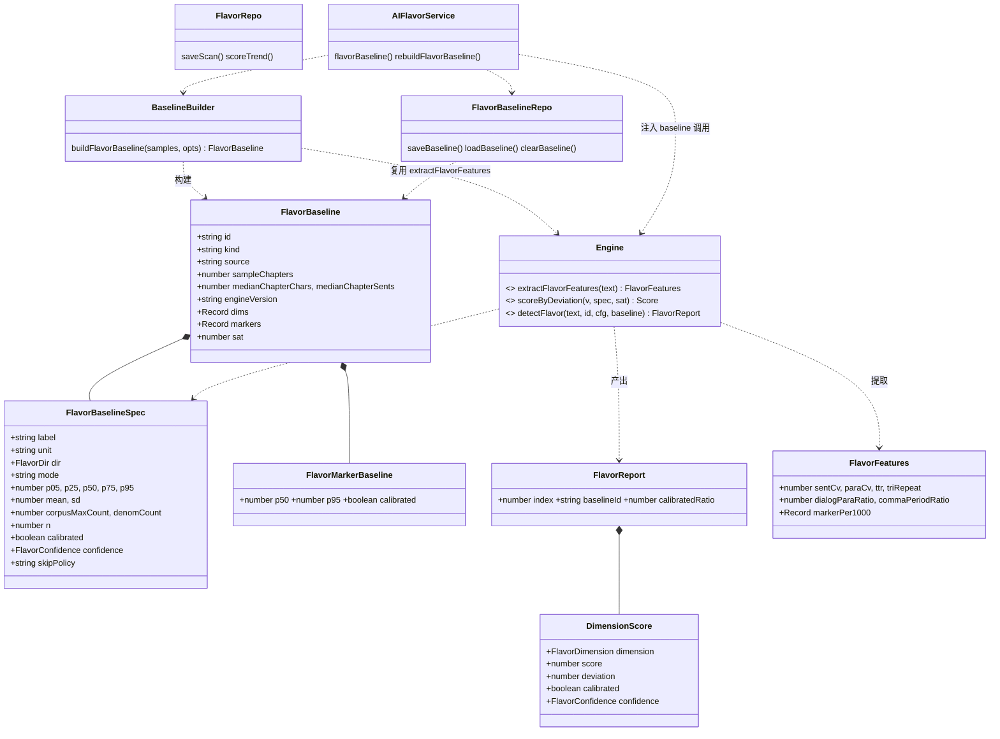
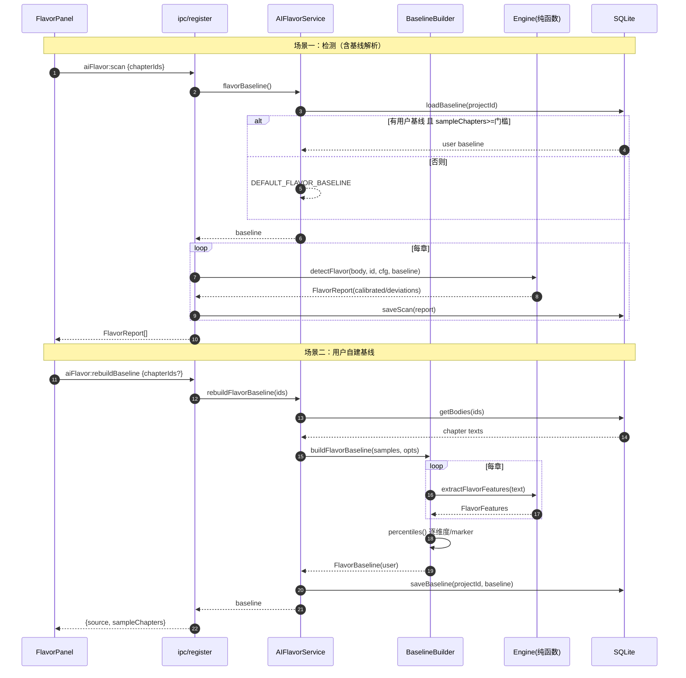

# 墨舟 AI 味检测 · 语料基线校准设计（增量）

> 板块：AI 味检测（`src/shared/ai-flavor/*`）
> 性质：**增量设计**，在已上线引擎上做「基线校准 + 判据重定义」，不重写板块
> 作者：高见远（架构师）· 2026-10-07
> 依据语料：《系统面板永远是零》定稿 **715 章 / 1,515,404 字**（作者本人作品）
>
> **版本 v2（修订）**：并入 715 章**全维度、引擎口径**基线（`data/corpus_flavor_baseline.json`，engine md5 `53df218…` pin）。本版三项变更：
> ① 新增**零膨胀判据**（`connector_per1000`、`parallel_per100sent` 的 `p95=0`，原 span 除法会退化，必须修）；
> ② 由「4 维度未校准、不计入总指数」改为 **10 维度统一校准、默认全部纳入**；
> ③ 按实测复校 `comma_period_ratio` / `sent_cv` 的锚点与 note 文案。
>
> **版本 v3（修订）**：**零膨胀判据由「密度口径」改为「计数口径」**（长度无关）。原密度口径内嵌「文本≈2104 字」假设，实测 600 字章节写 1 个「然而」得 100 分、与 UI 文案口径冲突 → 改为按「每章命中次数」软饱和（§1.2.1）。同时 B11 改判「已核实、非风险」，补全 T03/T04 详细设计。

---

## 结论先行（TL;DR）

1. **判据重定义**：不把 `good/bad` 直接换成语料数字，而是把维度分重新定义为
   **「离你自己的正常写作范围有多远」**。核心公式（见 §1.2）：

   ```
   span = max(p95 − p05, ε)
   high-bad（越高越像 AI）：good = p95， d = max(0, (v − p95)/span)
   low-bad （越低越像 AI）：good = p05， d = max(0, (p05 − v)/span)
   score = round(clamp01(d / SAT) × 100)     // SAT = 1.0，可配
   ```
   **v 落在正常边界内 → 0 分；偏离达「一整个正常带宽度」→ 100 分。**

2. **方向口径修正（重要）**：任务书里「good 侧 = high-bad 维度用 p05 / low-bad 维度用 p95」的括注**两条都反了**。正确映射为 **high-bad→p95、low-bad→p05**，与项目既有 `src/shared/metrics-engine.ts` 的 `grade()`（high-bad `value<=p95→ok`、low-bad `value>=p05→ok`）完全一致。详见 §1.3。

3. **零膨胀判据（计数口径 · v3 修订）**：`connector` 与 `parallel` 的实测 **p95 = 0**（714/715、707/715 章为 0）。此时 `span = p95−p05 = 0`，主公式会让**任意一个「然而」把该维度打到 100 分**。改用**计数软饱和**（**长度无关**）：`score = clamp01(count / (KZ × max(corpusMaxCount, 1))) × 100`，`KZ=3`，`corpusMaxCount`=语料单章最大命中数（connector=**1**、parallel=**2**）→ `denomCount`=**3 / 6**。**出现 1 次恒 ≤33 分、语料极端章恒 33 分**——真·结构性杜绝「一个字眼定生死」。（v3 修订：上一版用**密度**口径，导致 600 字章节写 1 个「然而」得 100 分，已更正为计数。）见 §1.2.1。

4. **10 维度统一校准**：`opening-pattern`、`template-connector`、`punctuation-pattern`、`parallel-structure` 现已有语料基线（引擎口径），**全部正式纳入总指数**（上一版的「未校准、weight=0」分支删除）。保留「低置信度」徽标机制。零膨胀的 2 个维度用上面的软饱和判据。见 §2.1/§2.4。

5. **`paragraph-rhythm` 永久失效问题**：现行「段落中位 <120 字则跳过」对网文**永久失效**——实测 **715/715 章的段落中位数全部 <120**（范围 8~37，p50=14），该维度恒定 score=0。重设计为 **`para_cv` 低向判据**（基线 **p05=0.584 / p95=0.938**），护栏换成**校准过的对白护栏**（`dialog_para_ratio≥0.85 且 sents_per_para≤1.05`）。见 §3.3。

6. **marker-density 已整体校准**：引擎 `AI_MARKERS` **实为 9 条**（含朱雀 P1「副词+动词」），且引擎 `measured` 就是这 **9 条聚合密度**；新基线直接测了该聚合（p95=2.353）→ **维度按单一聚合判据校准**。逐类基线（原 Tier A/B 分层）**仅用于命中归因/文案**，不再影响维度分。见 §2.3。

7. **任务仍分 5 批**（§6）：T01 基座 → T02 引擎改造 → T03 自建基线 → T04 UI → T05 验收。

---

## 阅读约定：`【已确认】` / `【待验证】`

- **【已确认】**：有实测数字支撑（本设计中的 715 章分位数、marker 密度、派生分布均已由我逐项复核，与任务书完全一致）。
- **【待验证】**：无实测依据、或依赖后续补测/产品决策，**不得当既定事实使用**。

---

# 一、校准后的基线数据模型

## 1.1 为什么不是「把 good/bad 换成语料数字」

语料**全部是人写的**（作者本人定稿）。它能回答的是「**人写的正常范围长什么样**」，无法回答「AI 长什么样」——因为语料里没有一个 AI 样本。

所以旧式 `scale(value, good=人写典型值, bad=AI典型值)` 从根上有缺陷：`bad`（AI 值）**根本没有依据**，是拍脑袋。校准要做的是**换掉这个问题本身**：

| | 旧模型 | 新模型 |
|---|---|---|
| 判据提问 | 「你像不像 AI？」 | 「你离**你自己的**正常范围有多远？」 |
| good 依据 | 拍脑袋的「人写典型值」 | **语料分位数（实测）** |
| bad 依据 | 拍脑袋的「AI 典型值」 | **「显著偏离」的距离**（不假装知道 AI 值） |
| 优点 | — | 诚实 / 规避网文误判 / 契合「写作体检」定位 |

三条收益对应任务书的核心洞察，不再展开。

## 1.2 判据公式（核心）

设某维度实测值为 `v`，其基线分位数为 `p05`、`p95`，饱和系数 `SAT`（默认 1.0）。**先判是否零膨胀，再走主公式**：

```
if p95 == p05:                              // ★ 零膨胀 → 计数口径（§1.2.1，长度无关）
    c    = 该维度「每章命中次数」（整数 count）
    d    = c / spec.denomCount              // denomCount = KZ × max(corpusMaxCount, 1)
else:                                       // 常规：用正常带宽度作单位（密度/比率量）
    span = max(p95 − p05, EPS)
    if dir == 'high-bad':                    // 越高越像 AI
        good = p95
        d    = max(0, (v − good) / span)      // 只在超过上边界时为正
    else:                                    // low-bad：越低越像 AI
        good = p05
        d    = max(0, (good − v) / span)      // 只在低于下边界时为正

score = round( clamp01(d / SAT) × 100 )      // 0~100，越高越可疑
```

**语义**：

- `v` 落在正常边界之内（或更好一侧）→ `d=0` → **score 0**（不打扰用户）
- `v` 偏离达 **一整个正常带宽度**（`span`）→ **score 100**
- 零膨胀维度：命中次数达 **`denomCount`** 才 → **score 100**（见 §1.2.1）
- 中间线性插值（沿用引擎既有的「线性而非阶梯」原则，避免阈值附近分数跳变）

**与既有实现的关系**：`metrics-engine.ts` 的 `deviation()` 已用 `span = p95−p05` 作单位、以 `0.2` 为 warn 界；本公式是它的**连续化 + 加饱和常数 + 零膨胀分支**版本，口径同源。

**【待验证】`SAT` 取值**：任务书要求「定义显著偏离的距离」。语料只有人写值，**无法验证「偏离一个带宽就算 100 分」是否恰好**。故 `SAT` 必须**可配**，默认 `1.0`（偏保守，宁少报勿冤枉），并在 UI 以「偏离度」原样呈现原始 `d`，让用户看到依据而非只看扑克牌分数。

## 1.2.1 零膨胀判据（`p95 == p05`）— **计数口径（v3 修订）** ★

**触发**：`connector`（模板连接词）与 `parallel`（对仗结构）的 **p95 = 0**（人写口语化网文里几乎不出现：714/715、707/715 章为 0）。代入主公式 `span=0 → d=v/ε → 任意一次命中即 100 分`——**一个字眼定生死**。

### ❌ 为什么上一版的「密度口径」是错的（本轮修订原因）

上一版用**密度**（per1000 / per100sent）软饱和，并声称「出现 1 次 ≤33 分」是**结构性保证**。**该结论不成立**——它只在「文本≈2104 字（中位章长）」时成立。实测反例（固定 1 个「然而」，只改长度）：

| 文本长度 | 密度(/千字) | 旧（密度口径）得分 |
|---:|---:|---:|
| 600 字 | 1.67 | **100** |
| 1127 字 | 0.887 | 62 |
| 1967 字 | 0.508 | 36 |
| 2804 字 | 0.356 | 25 |

根因：`unitDensity = 1000 / 中位章长` 这个常量**内嵌了「文本≈2100 字」的假设**，密度本身是长度相关的量。**600 字章节写 1 个「然而」得 100 分，不可接受**；且与 UI 文案「约 3 次/章才算显著」**口径不一致**（一个是密度、一个是计数）。

### ✅ 判据（计数软饱和）——长度无关

```
unit  = 「每章出现次数」count（整数，非密度）
        connector: TEMPLATE_CONNECTORS 命中数
        parallel : PARALLEL_PATTERNS   命中数

corpusMaxCount = 语料里「单章最大命中次数」= max_i(count_i)     // 实测整数
        connector = 1     parallel = 2
denomCount = KZ × max(corpusMaxCount, 1)                        // KZ = 3，可配
        connector = 3     parallel = 6
score = round( clamp01( count / denomCount ) × 100 )
```

**取值对照（长度无关——600 字与 3000 字同一结果）**：

| 指标 | denomCount | 出现 1 次 | 出现 corpusMaxCount | 拉满(=100) |
|---|---:|---:|---:|---:|
| `template-connector` | `3×max(1,1)=3` | 1 → **33** | 1 → **33** | ≥3 处/章 |
| `parallel-structure` | `3×max(2,1)=6` | 1 → **17** | 2 → **33** | ≥6 处/章 |

> **`corpusMaxCount` 必须取「实际单章最大命中数」（整数），不能再用 `corpusMaxDensity × 中位长度` 折算**——后者对 `parallel` 会给出 1.85×168/100=3.11（→denom 9.3），而**实际**最极端的一章只用了 **2 处**。用整数 count 既精确又无长度假设。

### 为什么这样不会「一个字眼定生死」（现在是**真·结构性**保证）

1. **出现 1 次 → 恒 ≤33 分**（connector 33 / parallel 17），**与文本长度无关**；须达 `KZ×` 上限才 100；
2. **`corpusMaxCount` 恒映射到 33 分**（`KZ=3>1` → `corpusMaxCount/denomCount ≡ 1/3`）——**作者自己最极端的一章也只算轻微**；
3. **权重**（connector 0.12 / parallel 0.05）下，单次命中对总指数贡献 ≈ `33×0.12 ≈ 4` / `17×0.05 ≈ 1` 分，不足以劫持；
4. **与 UI 文案一致**：「约 3 次/章 / 约 6 次/章才算显著」直接对应 `denomCount`。

> ✅ 强信号保留：人写≈0、AI 才非零（0 次→0 分，非零→立即离开 0）。
> **注意不要误改**：`dash_ellipsis_per1000` 虽 p05=p50=p75=0 但 **p95=1.9283≠0** → 属**常规维度**，走主公式，**本次不改、保持密度口径**。
> **口径选择说明**：零膨胀维度用「每章次数」而非「每千字次数」，是因为「体检」问的是「**这一章你用了几次**」，且避开长度依赖。非零膨胀维度仍用密度/比率口径（它们的 p05/p95 本身即分布量，无退化问题）。

## 1.3 方向映射（含口径修正）

引擎维度按「坏的方向」分两类，**两类的正常边界在分位数的相反一侧**：

| 类型 | 含义 | 正常边界 `good` | 偏离方向 | 例 |
|---|---|---|---|---|
| `high-bad` | 值越高越像 AI | **p95**（上边界） | `v > p95` | `tri_repeat`、marker 密度 |
| `low-bad` | 值越低越像 AI | **p05**（下边界） | `v < p05` | `sent_cv`、`ttr`、`dialog_ratio` |

> ⚠️ **口径修正说明**：任务书写「good 侧 = 语料 p05（对 high-bad）/ p95（对 low-bad）」。经复核，**两条括注与语义相反**。
> 佐证：项目既有 `src/shared/metrics-engine.ts::grade()` 明确实现为——
> `high-bad: value<=p95 → ok`（边界=p95）、`low-bad: value>=p05 → ok`（边界=p05）。
> 若按任务书原文（high-bad 用 p05），`tri_repeat` 取语料中位 0.278 会被判分 ≈ (0.278−0.191)/(bad−0.191) > 0——**一半人写章节被误报**，与"不冤枉作者"目标直接冲突。
> 故本设计采用 **high-bad→p95、low-bad→p05**。此条列入「待团队确认」（见附录 B）。

## 1.4 需要哪些统计量——用 p05/p50/p95 够吗？

**结论：判据只用 p05/p95（稳健、不假设分布）；但数据结构建议存全量分位 + mean/sd。**

| 统计量 | 用途 | 是否必需 |
|---|---|---|
| p05 / p95 | **判据边界**（正常带两端） | ✅ 必需 |
| p50 | 展示「你的中位」、零膨胀 marker 的对照 | ✅ 建议 |
| p25 / p75 | 展示 IQR、confidence 估计 | ⭕ 建议 |
| mean / sd | 展示 + 交叉校验（**不作为判据**，避免正态假设） | ⭕ 建议 |
| n（样本章数） | 分位数可信度、confidence | ✅ 必需 |
| dir | 方向（high-bad/low-bad） | ✅ 必需 |

理由：`span` 用 p05/p95 差（分布无关、抗离群），比 sd 更稳；`mean/sd` 仅用于展示与 QC（例如「mean 与 p50 差 > 50% → 分布严重偏斜，置信度降级」）。

## 1.5 TS 数据结构（接口签名，非实现）

放在 `src/shared/ai-flavor/baseline.ts`（**纯数据模块，零 IO，与 `constants/metrics.ts` 同构**）：

```ts
import type { FlavorDimension } from './ai-flavor';   // 类型在 types/ai-flavor.ts

/** 方向：仅两类（AI 味维度都是有向的，不需要 'both'） */
export type FlavorDir = 'high-bad' | 'low-bad';

export type FlavorConfidence = 'high' | 'medium' | 'low';

/** 单维度基线规格 */
export interface FlavorBaselineSpec {
  label: string;
  unit: string;                    // '字' | '' | '/千字' ...
  dir: FlavorDir;
  /** ★ 判据模式：'deviation' 主公式；'zero-inflated' 零膨胀软饱和（§1.2.1） */
  mode: 'deviation' | 'zero-inflated';
  p05: number; p25: number; p50: number; p75: number; p95: number;
  mean: number;
  sd?: number;
  /** ★ 零膨胀（§1.2.1）：语料「单章最大命中次数」（整数，非密度） */
  corpusMaxCount?: number;
  /** ★ 零膨胀拉满阈值 = KZ × max(corpusMaxCount, 1)，建基线时预计算并存 */
  denomCount?: number;
  n: number;                       // 参与统计的章数
  /** ★ 本版 10 维度全部 true；保留该字段以便个别维度降级标注（UI 徽标） */
  calibrated: boolean;
  confidence: FlavorConfidence;
  /** 该维度是否「判定跳过」（对白驱动护栏/样本不足）——见 §3.3 */
  skipPolicy?: 'dialogue-guard' | 'shortsample';
}

/** marker 逐类密度基线（仅命中归因/文案，**不决定维度分**，见 §2.3） */
export interface FlavorMarkerBaseline {
  p50: number;
  p95: number;
  n: number;
  /** 该类是否有单类基线（引擎 9 类中 2 类有；无则仅出命中） */
  calibrated: boolean;
}

/** 一份完整基线（默认 715 章 或 用户自建） */
export interface FlavorBaseline {
  id: string;                      // 'default' | `user:${projectId}`
  kind: 'default' | 'user';
  source: string;                  // UI 展示来源文案
  sampleChapters: number;
  totalChars: number;
  /** 语料中位章节长度（展示/参考用；零膨胀已改计数口径，不再依赖它） */
  medianChapterChars: number;
  medianChapterSents: number;
  createdAt: number;
  /** 生成该基线所用的引擎口径版本（口径变了基线要重算） */
  engineVersion: string;
  /** 10 个维度各一条，**全部 calibrated=true**；`marker-density` 的 spec 即 9 类聚合 */
  dims: Record<FlavorDimension, FlavorBaselineSpec>;
  /** marker 逐类密度（归因用） */
  markers: Record<string, FlavorMarkerBaseline>;
  /** 判据饱和系数，默认 1.0 */
  sat: number;
}

/** 默认基线 = 715 章语料，编译进包（纯常量，禁 IO） */
export const DEFAULT_FLAVOR_BASELINE: FlavorBaseline;
```

**报告侧的扩展**（`FlavorReport` / `DimensionScore` 增字段）：

```ts
interface DimensionScore {
  // ... 既有字段（dimension/score/level/skipped/measured/baseline/note）...
  calibrated: boolean;             // 该维度本次是否用了已校准基线
  confidence: FlavorConfidence;
  deviation: number | null;        // 原始偏离度 d（未换算成分数），可核对
  band: [number, number] | null;   // 展示「你的正常范围 [p05,p95]」
}

interface FlavorReport {
  // ... 既有字段 ...
  baselineId: string;              // ★ 本次用的是哪份基线
  baselineSource: string;
  baselineStale: boolean;          // ★ 基线由旧口径生成（§4.6），不阻断、降置信
  calibratedRatio: number;         // 参与总评的已校准维度权重占比（置信度展示用）
}
```

**兼容性**：`DimensionScore` 新增字段为可选/带默认，老报告反序列化不报错。

---

# 二、逐维度校准方案

## 2.1 总表（10 维度统一校准 · 引擎口径）

基线来源：`data/corpus_flavor_baseline.json`（715/715 章，engine md5 pin）。**判据公式见 §1.2 / §1.2.1。**

| # | 维度 | 底层指标 | dir | p05 | p95 | 正常边界 good | 判据（score 计算） |
|---|---|---|---|--:|--:|:--:|---|
| 1 | `sentence-rhythm` | sent_cv | low-bad | 0.4907 | 0.6403 | **p05=0.4907** | `d=(0.4907−v)/0.1496` |
| 2 | `paragraph-rhythm` | **para_cv**（新） | low-bad | 0.584 | 0.938 | **p05=0.584** | `d=(0.584−v)/0.354` ＋对白护栏（§3.3）|
| 3 | `lexical-diversity` | ttr | low-bad | 0.1232 | 0.1937 | **p05=0.1232** | `d=(0.1232−v)/0.0705` |
| 4 | `phrase-repetition` | tri_repeat | high-bad | 0.1914 | 0.3825 | **p95=0.3825** | `d=(v−0.3825)/0.1911` |
| 5 | `opening-pattern` | opening_dup_ratio | high-bad | 0.077 | 0.214 | **p95=0.214** | `d=(v−0.214)/0.137` |
| 6 | `template-connector` | connector **次数/章** | high-bad | 0 | 0 | 零膨胀 | `score=clamp01(count/3)×100`（§1.2.1）|
| 7 | `marker-density` | ai_marker_per1000（9 类聚合） | high-bad | 0 | 2.353 | **p95=2.353** | `d=(v−2.353)/2.353` |
| 8 | `punctuation-pattern` | max(comma, dash) | high-bad | — | — | 复合 | 见下 |
| 8a | 　└ comma_period_ratio | high-bad | 0.487 | 0.99 | **p95=0.99** | `d=(v−0.99)/0.503` |
| 8b | 　└ dash_ellipsis_per1000 | high-bad | 0 | 1.9283 | **p95=1.9283** | `d=(v−1.9283)/1.9283`（**非零膨胀**）|
| 9 | `dialog-ratio` | dialog_para_ratio | low-bad | 0.4028 | 0.827 | **p05=0.4028** | `d=(0.4028−v)/0.4242` |
| 10 | `parallel-structure` | parallel **次数/章** | high-bad | 0 | 0 | 零膨胀 | `score=clamp01(count/6)×100`（§1.2.1）|

- **`punctuation-pattern`** 是两个子信号的 `max`（引擎既有行为）：`score = max(score(comma), score(dash))`，任一突出即该类问题。
- 所有维度 `calibrated=true`、`mode` 见 §1.5。**不再有「未校准/weight=0」分支。**
- **方向**：low-bad→good=p05（下边界）；high-bad→good=p95（上边界）。与 §1.3 口径一致。

> **验收（用 3 章真实原文复算，见附录 A.5）**：旧指数 3 / 17 / 28 → 新指数 **2 / 9 / 13**，全部 clean，且各命中维度分与偏离度自洽。

## 2.2 各维度：判据锚点与「说人话」文案

`note` 措辞一律从「像不像 AI」改为「离你的正常范围多远」，并显示 `your band [p05,p95]`：

| 维度 | 判据 | `note` 文案模板（bad 例） | 旧文案（错，需删） |
|---|---|---|---|
| `sentence-rhythm` | low-bad，good=**p05=0.4907** | 「句长变化度 0.46，低于你的正常范围 [0.49, 0.64]——节奏比平时更平」 | ~~人写通常 >0.55~~ |
| `paragraph-rhythm` | low-bad，good=**p05=0.584**（＋护栏） | 「段落长度变化度 0.45，低于你的正常范围 [0.58, 0.94]——段落比平时更等长」 | ~~段落中位<120 跳过~~ |
| `lexical-diversity` | low-bad，good=**p05=0.1232** | 「单字多样性 0.11，低于你的正常范围 [0.123, 0.194]」 | — |
| `phrase-repetition` | high-bad，good=**p95=0.3825** | 「三字片段重复率 47.7%，高于你的正常范围上限 38.3%（偏离 0.49 个带宽）」 | — |
| `opening-pattern` | high-bad，good=**p95=0.214** | 「有 N 句同一两字开头（占 25.4%），高于你的正常范围上限 21.4%」 | ~~同两字开头 >0.15~~ |
| `template-connector` | 计数软饱和（§1.2.1） | 「模板连接词出现 **2 处**：你的语料正常为 0；约 3 处/章才算显著」 | ~~>1.5/千字~~ |
| `marker-density` | high-bad，good=**p95=2.353** | 「AI 味标志词 3.4/千字，高于你的正常范围上限 2.35/千字」 | ~~>3/千字~~ |
| `punctuation-pattern`(comma) | high-bad，good=**p95=0.99** | 「逗号/句号比 1.1，高于你的正常范围上限 0.99——句式比平时更拖」 | ~~人写 1.2~2.5~~ |
| `punctuation-pattern`(dash) | high-bad，good=**p95=1.9283** | 「破折号/省略号 3.0/千字，高于你的正常范围上限 1.93」 | — |
| `dialog-ratio` | low-bad，good=**p05=0.4028** | 「对白段占比 12%，低于你的正常范围 [40%, 83%]——这一章叙述偏重」 | ~~<0.35~~ |
| `parallel-structure` | 计数软饱和（§1.2.1） | 「对仗式表达出现 **2 处**：你的语料正常为 0；约 6 处/章才算显著」 | ~~>1/百句~~ |

**三处文案锚点按实测复校（本版新增，重要）**：

1. **`comma_period_ratio`**：旧注释「人写网文常见 1.2~2.5」、`scale(good=2.5, bad=5.5)`。实测该书 **min 0.38 / p50 0.69 / max 1.27，仅 1/715 章落在 1.2~2.5** → 旧 good=2.5 严重偏高。**改用 good=p95=0.99**（当前不误报是因低于 2.5 一律 0 分，但文案会误导）。
2. **`sent_cv`**：旧注释「人写 >0.55」、`scale(good=0.6, bad=0.25)`。实测 **mean 0.5611、p25 0.53**（约半数章节 <0.55）→ 按 good=0.6 人写会稳定拿 10~25 分。**改用 good=p05=0.4907**（sent_cv 是 low-bad，边界在下侧；**不是** p95=0.6403——见附录 B8）。
3. **`AI_MARKERS` 实为 9 条**（非 8 条），第 9 条是朱雀 P1「副词+动词」；引擎 `measured` = 9 条聚合密度。见 §2.3。

**验收关键**：三章真实原文复算（附录 A.5）——旧 3/17/28 → 新 **2/9/13**；ch574 的 `phrase-repetition` 从 **100 降到 49**；ch237 的 `phrase-repetition` 从 32 降到 **0**（tri_repeat=0.195 < p95=0.3825，不再误报）。

## 2.3 `marker-density`：按 9 类聚合校准 ★

**事实更正**：引擎 `AI_MARKERS` **实为 9 条**（非任务书所述的 8 条），第 9 条是朱雀 P1「副词+动词」。引擎 `dimMarkerDensity` 的 `measured = AI_MARKERS 命中总数 × 1000 / chars`，即**这 9 条的聚合密度**。

**关键**：新基线直接测了这个**聚合**（`ai_marker_per1000`：p05=0, p50=0.94, **p95=2.353**, mean=0.9764）→ **`marker-density` 维度按单一聚合判据校准**，无需按类分层：

```
high-bad；good = p95 = 2.353；span = 2.353（p05=0）
score = clamp01( max(0, v − 2.353) / 2.353 ) × 100      // v 达 4.706/千字 → 100
```

**逐类基线（归因/文案用，不决定维度分）**：

原 Tier A/B 分层（语料 7 类 marker vs 引擎 9 类，仅 2 类重叠）**在评分上已不需要**——聚合覆盖了全部 9 条。逐类基线仅保留用于「是哪一类标志词在超量」的**命中归因**：

| 层级 | 成员 | 用于 |
|---|---|---|
| 有单类基线 | 引擎 9 类中与语料重叠的 2 类：`顿了一下`、`一X一X 叠词` | 命中可带「该类你的人写基线 p95=x」 |
| 无单类基线 | 余下 7 类（`瞳孔紧缩`/`深吸一口气`/`嘴角勾起`/`不易察觉`/`复杂的情绪`/`空气仿佛凝固`/`副词+动词`） | 仅出命中 + 改法，不带单类基线 |

- 上述 2/7 的划分（`calibrated` 字段）**不影响维度分**，只影响逐类 note 的措辞。
- 语料另有一组 7 类 marker（`看了X遍`/`把X放在`/`第N天`/`没说话`/`抬起头` 等）属 **`metrics-engine.ts` 的 `MARKERS`**，**不是**引擎 `AI_MARKERS`，不参与本维度；它们的基线在健康板块（`metrics.ts`）里。

> 【待验证】若后续想给出「逐类超量」提示，需一次性补测 7 类非重叠 marker 的单类密度（用引擎正则跑 715 章）。当前**不做**，聚合判据已足够。

## 2.4 维度纳入策略（全量校准后）

上一版判为「未校准、weight=0」的 4 个维度（`opening-pattern` / `template-connector` / `punctuation-pattern` / `parallel-structure`）**现已全部具备语料基线**（`opening_dup_ratio` / `connector_per1000` / `comma_period_ratio`+`dash_ellipsis_per1000` / `parallel_per100sent`，见 §2.1）。故：

1. **10 个维度默认全部纳入总指数**（权重见 §3.5），`calibrated=true`；
2. **删除「未校准维度/weight=0」分支**；
3. 保留**低置信度徽标机制**（`confidence` 字段）——用于将来个别维度数据不足时降级提示，**本版无维度触发**；
4. `strictCalibration` 开关**保留**（可配），语义改为：「仅当维度 `confidence='low'` 时是否计入总指数」，默认 `true`（全部计入）。

**零膨胀维度（`template-connector` / `parallel-structure`）的纳入**：它们**正式计入**，判据用 §1.2.1 软饱和（非主公式），因为 `p95=0` 不是「没数据」，而是「**人写就是 0**」这一**强事实**——正是最干净的判据来源。软饱和保证「出现 1 次不误伤」。

> **关于「用 3 章原文现算并标低置信度」**：仍**不推荐**作为维度基线（3 章的 p05/p95 就是 min/max，无统计意义）。3 章原文的正确用途是**验收**（附录 A.5 已用）。

---

# 三、引擎改造

## 3.1 现状与核心问题

**三个必须解决的架构问题**：

1. **硬编码 → 从基线读**：各 `dimXxx()` 不再写死 `good/bad`，改读 `FlavorBaselineSpec`；
2. ~~口径漂移~~ **已解决**：默认基线已用**引擎自身口径**（esbuild 打包真实 `engine.ts` 直读 `measured`）在 715 章上重算，715/715 成功、零漂移（`data/corpus_flavor_baseline.json`，engine md5 pin）。故不再需要「先用 metrics.js 值再对齐」的过渡；
3. **零膨胀退化**（§1.2.1）：`connector_per1000`/`parallel_per100sent` 的 `p95=0` 会让 `span` 除法爆表 → 必须走软饱和分支，不能直接套主公式。

**硬编码现状（待替换）**：引擎当前把 `good/bad` 写死在各 `dimXxx()`：
- `dimSentenceRhythm`: `scale(cv, 0.6, 0.25)`（good 应 = p05 **0.4907**）
- `dimLexicalDiversity`: `scale(ttr, 0.12, 0.06)`（good≈p05，基本对）
- `dimPhraseRepetition`: `scale(rr, 0.1, 0.4)` ← **最严重**：good=0.1 远低于 p95=0.3825，导致**语料中位章节（0.278）就得分 ≈59**，即一半人写章节被误报
- `dimDialogRatio`: `scale(ratio, 0.35, 0.05)`（good 应 = p05 **0.4028**）
- `dimParagraphRhythm`: `scale(cv, 0.75, 0.3)` + `median<120` 跳过门（对网文永久失效，改为 `para_cv` §3.3）
- `dimPunctuationPattern`: `scale(comma, 2.5, 5.5)`（good 应 = p95 **0.99**）

## 3.2 新接口（保持纯函数）

引擎仍是**纯函数、零 IO、零 Node import**。基线作为**纯数据**注入。

```ts
// src/shared/ai-flavor/engine.ts

/** 从原文提取各维度原始特征（供检测与基线生成共用，保证口径同源） */
export interface FlavorFeatures {
  sentCv: number; sentCount: number;
  paraCv: number; paraCount: number;
  ttr: number;
  triRepeat: number;
  dialogParaRatio: number;
  openDupRatio: number;              // 句首两字最大重复占比（opening-pattern 用）
  connectorCount: number;            // ★ 模板连接词命中次数（整数；零膨胀计数口径 §1.2.1）
  markerPer1000: Record<string, number>;   // 逐类 marker 密度（归因用）
  markerTotalPer1000: number;        // ★ 9 类 AI_MARKERS 聚合密度（marker-density 维度分用它）
  commaPeriodRatio: number; dashPer1000: number;
  parallelCount: number;             // ★ 对仗结构命中次数（整数；零膨胀计数口径 §1.2.1）
}
export function extractFlavorFeatures(text: string): FlavorFeatures;

/** 核心：按基线把特征值映射成 0~100 维度分（见 §1.2 / §1.2.1） */
export function scoreByDeviation(
  value: number,
  spec: FlavorBaselineSpec,          // spec.mode 决定走主公式 or 零膨胀软饱和
  sat: number,
): { score: number; deviation: number };

/** 主入口：新增可选 baseline 参数，默认内置默认基线 */
export function detectFlavor(
  input: string,
  chapterId: string,
  cfg?: FlavorConfig,
  baseline?: FlavorBaseline,          // 缺省 = DEFAULT_FLAVOR_BASELINE
): FlavorReport;

export const FLAVOR_ENGINE_VERSION = '2.0.0';   // 口径变更 → 主版本 +1
```

- `extractFlavorFeatures` 是**新增导出**，既给 `detectFlavor` 用，也给用户自建基线的构建器用 → **口径唯一来源**。
- 每个 `dimXxx(spec)` 改为接收自己的 `FlavorBaselineSpec`，调用 `scoreByDeviation`；`spec.mode` 决定走主公式还是零膨胀软饱和（§1.2/§1.2.1）。`skipPolicy` 处理对白护栏/样本不足。
- **零膨胀维度**（`template-connector` / `parallel-structure`）：`spec.mode='zero-inflated'`，用 `spec.denomCount` 对「每章命中次数」软饱和（§1.2.1）；10 维度**全部** `calibrated=true`、默认计入总指数（§2.4）。

**基线解析位置**：引擎**不读库**。主进程在调用前解析「用户基线 or 默认基线」并注入（见 §3.4、§4）。

## 3.3 `paragraph-rhythm` 重设计 ★

**旧逻辑死锁**：`median(段长) < 120 → 跳过`。实测 **715/715 章的段落中位数全部 <120**（范围 **8~37**，p50=14）→ 该维度对本书**100% 不参与判定**，恒定 score=0，形同虚设。基线报告明确结论：「该维度对网文几乎零贡献」。

**数据支撑（引擎口径，715 章，【已确认】）**：

- `para_cv`（引擎 `dimParagraphRhythm.measured`，即 para_sd/avg_para）：**p05=0.584**、p50=0.718、**p95=0.938**、mean=0.733、min=0.446、max=1.146
- `corr(para_cv, dialog_para_ratio) = 0.24`（**弱相关**）
- 对白密集章（`dialog_para_ratio≥0.7`，n=274）：`para_cv` p05=0.604、p50=0.746
- 对白稀疏章（`<0.4`，n=35）：`para_cv` p05=0.546、p50=0.646

**关键发现**：对白密集章段的 `para_cv` **并不偏低**（p05=0.604 > 全体 p05=0.584）。说明「对白驱动」**不会**系统性压低 `para_cv`——旧护栏「短段落=对白驱动=跳过」是**误判**。真正的对白误报只出现在「纯对白墙」（几乎无叙述）。

**重设计判据**：

```
特征：para_cv = para_sd / avg_para          （low-bad：越低 = 段落越等长 = 越可疑）
正常带：[p05=0.584, p95=0.938]，span=0.354，good=p05=0.584
     d = (0.584 − para_cv) / 0.354
护栏（替换旧的 median<120）：
    若 dialog_para_ratio ≥ 0.85 且 sents_per_para ≤ 1.05
       → score=0, note='对白驱动的短句排版，不计入段落节奏判定'
```

**为什么新护栏更对**：全体语料 `dialog_para_ratio` p95=0.827 → 真实网文只有 <5% 章节达 0.85；而合成「纯对白墙」样本（12 行纯对白）`dialog≈1.0`、`sents_per_para≈1.0` → 被正确跳过。

**实测自检**：

- 测试样本 `longUniform`（6 段完全相同长段）：`para_cv=0` → `d=(0.584−0)/0.354=1.65` → **score=100**（>60，原测试通过）
- 测试样本 `dialogPaced`（纯对白）：触发护栏 → `score=0`，`note` 含「对白驱动」→ **原测试通过**
- 三章真实原文（引擎口径）：ch1 `para_cv=0.803`（带内→0）、ch574 `0.547`（略低于 p05，d=0.10→≈10）、ch237 `0.446`（**全语料最小值**，d=0.39→≈39）。→ **不再"永久失效"**，且只在真·离群章上报警（ch237 确是全 715 章里段落最等长的一章，报它有据可依）

> 【待验证】`avg_para` 本身也可作 `both` 向补充信号（语料 p05=12.457 / p95=29.002）。是否叠加留待验收数据决定；**首版只用 `para_cv` + 护栏**，保持单一判据可解释。

## 3.4 向后兼容

`FLAVOR_ENGINE_VERSION` 从 `1.0.0` → **`2.0.0`**（口径破坏性变更：同名维度、不同基线 → 分数不可比）。

| 对象 | 处理 |
|---|---|
| 老 `flavor_scans` 行 | 保留，`engine_version='1.0.0'` 不迁移 |
| 老报告趋势 | `FlavorRepo.scoreTrend()` 已按 `engine_version` **过滤不同口径记录** → 老分数不会混进新趋势曲线 ✅（机制已存在，无需改） |
| 老报告反序列化 | `FlavorReport` 新增字段（`baselineId` 等）设为可选，老 JSON 反序列化不报错 |
| 老报告展示 | 面板读到 `engineVersion !== FLAVOR_ENGINE_VERSION` 时，标「该结果由旧口径产生，建议重新检测」 |
| 配置兼容 | `FlavorConfig` 新增 `strictCalibration?: boolean`（语义：`confidence='low'` 的维度是否计入总指数，默认 `true`）、`baselineId?`，用默认值兜底（沿用 `{...DEFAULT, ...stored}` 合并），老配置不缺字段 |

## 3.5 权重是否需要调整（架构判断）

**结论：本版保持现有权重向量不变**，理由与保留意见如下：

| 维度 | 现权重 | 判断 |
|---|---:|---|
| `marker-density` | 0.18 | 保留（命中即确凿、改动动作明确）|
| `template-connector` | 0.15 | 保留（**实测精度最高**：人写 714/715 为 0，命中几乎必真；但召回低——很多 AI 文本也少用连接词）|
| `phrase-repetition` | 0.14 | 保留 |
| `sentence-rhythm` | 0.12 | 保留 |
| `lexical-diversity` | 0.10 | 保留 |
| `paragraph-rhythm` | 0.08 | 保留（现在**真的会触发**了，从"死维度"复活）|
| `opening-pattern` | 0.08 | 保留 |
| `punctuation-pattern` | 0.05 | 保留 |
| `dialog-ratio` | 0.05 | 保留 |
| `parallel-structure` | 0.05 | 保留（零膨胀 + 低基率，权重低是对的）|

- **为什么不按数据重新优化权重**：权重的最优解需要「人写 vs AI」的**正负样本对照**来拟合；本项目**没有任何 AI 样本**，任何基于分布的权重微调都是**伪优化**（把拍脑袋从一个参数搬到另一个参数）。故权重继续承载**「可改动性/精度」**这一先验，不动。
- **零膨胀的「单字眼劫持总分」风险已由公式消除**（§1.2.1）：出现 1 次 → 该维度 ≤33 分 → 对总指数贡献 ≈ `33×weight`（connector ≈4 分、parallel ≈2 分），**不再是 100×weight**。故无需为防劫持而下调权重。
- **可选增强（不建议本版做）**：若要「等化各维度误报率」，可按各自正常带宽度做逆方差加权；但那会引入难以向用户解释的隐权重，且缺 AI 样本无法验证收益。**列入 §附录 B9**，待有正负样本后再议。

---

# 四、用户自建基线

## 4.1 意义

每个作者的正常范围不同。715 章语料只是**默认基线**；用户导入/打开自己的项目后，应能**用自己已有的稿子重建基线**（这正是原型的 `rebuildBaseline()` 思路，`services.ts` 已有 health 板块的同名实现可参照）。

## 4.2 接口设计

`src/main/flavor/baseline-builder.ts`（main 层，可读文件/DB）：

```ts
export interface BuildOptions {
  chapterIds?: string[];        // 缺省 = 项目全部章节
  minChapters?: number;         // 门槛，默认 10（硬底线）
  minCharsPerChapter?: number;  // 复用引擎 minChars，默认 200
}

/** 从一批章节算出一份 FlavorBaseline（对每章走 extractFlavorFeatures 再取分位数） */
export function buildFlavorBaseline(
  samples: { chapterId: string; text: string }[],
  opts: BuildOptions,
  engineVersion: string,
): { baseline: FlavorBaseline; used: number; skipped: number; warnings: string[] };
```

主进程入口（`services.ts`）：

```ts
/** 解析当前生效基线：有用户基线且样本达标 → 用户；否则默认 */
flavorBaseline(): FlavorBaseline;

/** 用当前项目语料重建并保存 */
async rebuildFlavorBaseline(chapterIds?: string[]): Promise<FlavorBaseline>;
```

## 4.2.1 `buildFlavorBaseline` 算法（T03 实现要点）★

**唯一铁律：基线与检测必须同口径**。故必须复用引擎的 `extractFlavorFeatures()`（不另写统计），且**输入约定一致：两者都只吃「正文」，不含标题行**。

> ★ **重要约定（B11 已核实，非风险）**：`Chapter.body` 天然不含标题（`title` 在 `meta` 里，见 `project.ts:36-40`），`chapter_bodies` 表也只存 `body`（`migrate.ts:52-55`）。基线脚本「丢首行=标题」**等价于「只测正文」**，与引擎 `detectFlavor(body)` 测的是同一个东西。
> **因此：检测路径与建基线路径都【不要】再加「去首个非空行」逻辑**——传进去的已是正文，再删就是把**第一段正文**当标题删掉（每章丢一段，实为引入 bug）。
> 该约定改为在 `detectFlavor` 的 JSDoc 写明契约（`@param input 章节正文，不含标题行`），并用测试锁住（同一章测 body-only vs 标题+body，断言指数差 ≤1）。

```
输入：samples[{chapterId,text}], opts, engineVersion
输出：{ baseline, used, skipped, warnings }

Step 0  输入即正文（★ 不做任何删行变换）
        每章取项目里的 `body`（已是正文、不含标题）；
        仅当从原始 .md 文件解析时（另一条路径）才需剥首行——但那不是 T03 的输入源。
Step 1  逐章提特征
        for s of samples:
            f = extractFlavorFeatures(pre(s.text))
            if f.chars < opts.minCharsPerChapter: skipped++; continue   // 复用引擎 minChars=200
            used++; 把 f 的各指标值 push 进对应数组
                    （密度类：sent_cv/para_cv/ttr/tri_repeat/opening_dup/comma/dash/dialog；
                     计数类：connectorCount/parallelCount —— 整数，供零膨胀用；逐类 marker）
Step 2  逐维度求分位
        对每个维度指标数组 vals：
            n = vals.length
            若 n < opts.minChapters: 该维度 mark 为回退默认（见 Step 6）
            否则 p05/p25/p50/p75/p95 = percentiles(vals)  // 线性插值，同基线脚本
                    mean/sd/min/max 一并算出（展示 + QC）
Step 3  定 mode（零膨胀自适应）
        if p95 == 0 (且 p05 == 0):  mode = 'zero-inflated'        // connector / parallel
             corpusMaxCount = max_i( 该章【整数命中次数】 )        // ★ 计数口径，非密度
                              connector=1 ; parallel=2
             denomCount     = KZ × max(corpusMaxCount, 1)          // KZ=3 → 3 / 6（§1.2.1）
        else:                       mode = 'deviation'
Step 4  定 dir（不随语料变）
        直接从 DEFAULT 继承该维度的 dir（sent_cv/ttr/para_cv/dialog = low-bad；其余 high-bad）
        —— 方向是维度语义，不是语料属性，用户语料不能翻转它。
Step 5  定 confidence
        n≥30 → high ; 10≤n<30 → medium ; n<10 → low（并触发回退）
Step 6  回退与兜底
        任一维度 n<minChapters 或 vals 全空 → 用 DEFAULT 的该维度 spec，标 calibrated=false、低置信
        逐类 markers 同理（某类全零无法定 p95 → 回退 DEFAULT）
Step 7  组装 FlavorBaseline
        id=`user:${projectId}`、kind='user'、
        medianChapterChars/Sents 由 samples 章长中位算、
        source=`你的语料（used 章，按章分位数）`、engineVersion、sat=DEFAULT.sat
        warnings：用「跳过章数 / 回退维度 / 样本偏少」填充，回传 UI 提示
```

**为什么用「按章分位数」而非拼接全书**：分位数要的是「章的分布」，不是「全书一个平均」。拼接会把 715 章揉成 1 个样本，丢失章间波动（与 `services.ts::rebuildBaseline()` 既有做法一致）。

## 4.3 存哪

**新增迁移 v7**（`migrate.ts` 只增不改）：

```sql
-- v7: add_flavor_baseline
CREATE TABLE IF NOT EXISTS flavor_baselines (
  project_id     TEXT PRIMARY KEY,
  id             TEXT NOT NULL,        -- 'user:<projectId>'
  source         TEXT NOT NULL,
  sample_chapters INTEGER NOT NULL,
  total_chars    INTEGER NOT NULL,
  engine_version TEXT NOT NULL,        -- 口径版本：变了要重算
  baseline       TEXT NOT NULL,        -- JSON：完整 FlavorBaseline
  updated_at     INTEGER NOT NULL
);
```

**为什么单开表而不是塞进 `flavor_config`**：`flavor_config` 存的是**用户开关**（配置），本表存的是**派生数据**（统计结果），语义不同；与既有 `style_profiles` 表同构，风格一致。删板块时一并删。

配套 `FlavorRepo`（或新 `FlavorBaselineRepo`）新增：`saveBaseline / loadBaseline / clearBaseline`。

## 4.4 与默认基线的关系

**语义 = 逐字段覆盖 + 兜底**（与 `services.baseline` getter 一致，见 `services.ts:427`）：

```
effectiveBaseline =
  用户基线存在 && sampleChapters ≥ 门槛
     ? { ...DEFAULT, ...用户基线 }          // 用户有值的覆盖，缺失的 marker/维度回退默认
     : DEFAULT
```

- **不是**「合并平均」——用户语料就是权威，不与他人语料混合；
- **是** per-field 覆盖：用户语料缺某字段时回退默认；
- **零膨胀维度随用户语料自适应**：若用户语料里 `connector`/`parallel` 的 p95 也 ≈0 → 保持 `mode='zero-inflated'`；若用户语料该指标非零 → 自动降级为 `mode='deviation'`（用用户自己的 p05/p95）。**这是自建基线相对默认基线的核心增益**：不同作者的"正常"不同。
- 逐类 `markers`：用户语料某类全程零命中（无法定 p95）时回退默认，标 `calibrated=false`（仅影响归因文案，不影响维度分）。

## 4.5 样本量门槛【待验证】

三级门：**章数门**（决定是否启用用户基线）、**单章字数控**（决定哪些章进样本）、**单维度 n**（决定该维度是否回退）。

| 层 | 阈值 | 不达标时 |
|---|---|---|
| 章数（used） | `< 10` 不启用；`10–29` 可用(medium)；`≥ 30` 推荐(high) | 不启用 → 继续用默认基线 + 提示「你的语料不足 10 章，暂用示例基线」 |
| 单章字数 | `minCharsPerChapter = 200`（复用引擎 `minChars`） | 该章跳过（计入 skipped），不进样本 |
| 单维度 n | `n < minChapters(10)` | 该维度回退默认、标 `calibrated=false` |

- **为什么章数门槛 10**：p05/p95 是**极值分位**，n=10 时它们几乎等于 min/max（不稳）——故 10 只是「能用的下限」（沿用 `services.ts` 既有约定），**30 章才稳**。
- 阈值全部进配置（`BuildOptions` / `FlavorConfig`），**不硬编码**。
- 重建后把 `used / skipped / 回退维度列表` 回传 UI（§5），让用户知道基线质量。

## 4.6 基线陈旧（口径变更）处理 — `baselineStale`

存储基线带 `engine_version`（§4.3）。当 `stored.engineVersion !== FLAVOR_ENGINE_VERSION`（引擎口径已变）时：

**策略 = 不阻断（采用方案 b）**：

1. **仍可用**旧基线继续检测——用户不该被一次版本升级卡住；
2. 但打标 `FlavorReport.baselineStale = true`，**降置信度**（该报告 confidence 下调一档），并在 UI 顶部提示条：`当前基线由旧口径（v1.0.0）生成，建议重建以保证可比`；
3. `flavorBaseline()` 返回值带 `stale: boolean`；`rebuildFlavorBaseline()` 后清除；
4. **不做自动重建**——重建是有成本的 IO（读全书），且用户可能正想看旧基线下的一致性，交给用户点按钮。

> 与 §3.4「老报告 engineVersion≠当前 → 建议重测」是**两条不同提示**：一条针对**报告**（结果口径），一条针对**基线**（基准口径），UI 要分开显示，勿合并成一句话。

---

# 五、UI 呈现（T04）

复用现有模块样式与设计令牌，**不引新色系**。三块新增：基线来源栏、单维度正常带、置信度。

## 5.1 基线来源栏（顶部常驻）

三种状态，一眼可辨「这份分数基于谁的标准」：

| 状态 | 文案 | 样式 | 动作 |
|---|---|---|---|
| **默认** | `基线：默认（《系统面板永远是零》715 章）` | 中性灰 | 「用我的语料重建」按钮 |
| **用户** | `基线：你的语料（N 章 · medium）` | 强调色（表示更贴合本人） | 「重建 / 删除」 |
| **陈旧** | `基线由旧口径生成，建议重建` 挂一条警示 | 警示黄 | 「重建」 |

- 来源文案直接取 `baseline.source`；`baselineStale`（§4.6）触发警示条——**与报告级的「旧口径结果」提示分开显示**（§4.6 注）。
- 用户基线**样本太少**（used<10）时不显示为用户态，退回默认态 + 一句 `你的语料还不足 10 章`。

## 5.2 单维度正常带可视化 ★

每个维度行在分数之外，增加一条**正常带轨道**，让「离你的正常范围多远」可见（而非只看 0–100）：

```
句子节奏   │▓▓▓▓████░░░░░░░│ 实测0.46   18
              ↑p05  ↑↑p95
              [0.49 ──── 0.64]        偏离 0.21 带宽
```

可视规范（用 CSS 即可，无需图形库）：

- **轨道**：横向 100%，映射该维度 `[min, max]`（用基线 min/max 或 `[p05−2·span, p95+2·span]` 定界，避免离群点挤扁）；
- **正常带**：`[p05, p95]` 区段用低饱和底色 `▓`（=「你平时就在这区间」）；
- **实测点**：`▮` 竖线标 `measured`，落在带内 → 绿/中性；落在带外 → 按 `deviation` 着色（预警色）；
- **文字**：`实测 0.46 ｜ 你的正常范围 [0.49, 0.64] ｜ 偏离 0.21 带宽`。

**零膨胀维度**（`template-connector`/`parallel-structure`）特殊呈现——无「带」，改为**计数条**（计数口径 §1.2.1，长度无关）：

```
模板连接词   出现 2 处   你的语料正常为 0     67
             提示：约 3 处/章才算显著；出现 1 次仅 33 分，与文本长度无关

对仗式表达   出现 2 处   你的语料正常为 0     33
             提示：约 6 处/章才算显著
```

## 5.3 置信度表达

总分旁一行，由「**样本是否足够**」×「**校准维度占比**」×「**基线是否陈旧**」三者合成：

```
可信度 = 档( sufficient ? 1 : 0.5 )
       × 档( calibratedRatio )              // 已校准维度权重占比
       × ( baselineStale ? 0.7 : 1 )        // §4.6
显示：可信度高 / 中 / 低（≥0.8 高；≥0.5 中；否则低）
并附括号说明：`（10/10 维度已校准 · 样本 2104 字 · 用户基线）`
```

- `dimensions` 里 `confidence='low'` 的维度，单独在维度行加灰底徽标 `低置信度`（本版默认基线无触发；用户自建样本少时可能出现）；
- **不显示「AI 概率%」**——confident 的是「偏离度」，不是「AI 概率」（延续免责声明）。

## 5.4 交互与文案

- **「重建基线」**：点击 → `aiFlavor:rebuildBaseline` → Loading「正在读你的稿子…」→ 结果 `已用 N 章重建（跳过 M 章样本不足，K 个维度回退默认）` → 自动重跑当前章检测并刷新来源栏。
- **措辞原则（硬约束）**：所有结论必须是「**偏离你的常态**」，不是「像 AI」。例：`对白段占比 12%，低于你的正常范围 [40%, 83%]` ✅ / `对白太少，像 AI` ❌。
- 空/短章：`sufficient=false` 时正常带仍显示，但总分置灰 + 沿用既有 `insufficientReason`。

---

# 六、任务分解

**5 批**（每批 ≥3 文件；T01 为基座；尽量并行、少线性依赖）：

### T01 基线数据与持久化基座　（P0）　依赖：无
| 项 | 内容 |
|---|---|
| 新增文件 | `src/shared/ai-flavor/baseline.ts`（类型 + `DEFAULT_FLAVOR_BASELINE` 常量 + `medianChapterChars/Sents`）<br>`src/main/db/repos/flavor-baseline-repo.ts`（DAO）<br>`scripts/gen-flavor-baseline-ts.mjs`（读 `data/corpus_flavor_baseline.json` → 生成 `baseline.ts`；零膨胀项由 perChapter **整数 count** 求 max → `corpusMaxCount`=**1/2**、`denomCount`=**3/6**） |
| 修改文件 | `src/shared/types/ai-flavor.ts`（`DimensionScore`/`FlavorReport` 扩字段）<br>`src/main/db/migrate.ts`（**v7** `flavor_baselines`） |
| 实现要点 | 类型照 §1.5（含 `mode`/`corpusMaxCount`/`denomCount`）；迁移只增不改；常量**用基线文件生成、勿手抄** |
| 验收 | typecheck 过；v7 可升可退；`DEFAULT_FLAVOR_BASELINE` 含全部 10 维度（`calibrated=true`）+ 2 个零膨胀维度带 `corpusMaxCount`/`denomCount`（应为 1/3 与 2/6） |

### T02 引擎改造 + 维度校准　（P0）　依赖：T01
| 项 | 内容 |
|---|---|
| 修改文件 | `src/shared/ai-flavor/engine.ts`（+`extractFlavorFeatures`、`scoreByDeviation`（含 `mode` 分支）、各 `dimXxx(spec)`；`paragraph-rhythm` 重设计；`punctuation-pattern` 双锚点复校；版本→2.0.0）<br>`tests/unit/ai-flavor-engine.test.ts`（更新段落护栏断言、`comma`/`sent_cv` note 断言、新增零膨胀用例） |
| 实现要点 | §1.2 主公式 + **§1.2.1 零膨胀软饱和**；§2.2 逐维锚点；§3.3 段落重设计；**纯函数**（grep 确认零 Node/IO） |
| 验收 | ① 三章真实原文指数降至 **2/9/13**（附录 A.5）；② 段落节奏两条既有测试仍通过；③ **零膨胀单测**：`connector=1 次` 该维度 ≤33 分（非 100）、`connector=0` 为 0；④ ch237 的 `phrase-repetition` 归 0 |

### T03 用户自建基线　（P0）　依赖：T01、T02
| 项 | 内容 |
|---|---|
| 新增文件 | `src/main/flavor/baseline-builder.ts`（`buildFlavorBaseline`，算法见 §4.2.1） |
| 修改文件 | `src/main/services.ts`（`flavorBaseline()` / `rebuildFlavorBaseline()`，含 `baselineStale` §4.6）<br>`src/main/ipc/register.ts`（`aiFlavor:baseline` / `aiFlavor:rebuildBaseline`；`scan` 注入生效基线）<br>`src/shared/types/ipc.ts`（2 通道 + DTO）、`src/preload/api.ts`、`src/preload/index.ts` |
| 实现要点 | §4.2.1 七步算法；★**输入即 `body`（已不含标题）——不要加「删首行」逻辑**（B11 已核实）；零膨胀 `mode` 自适应（§4.4）；`scan` 调 `detectFlavor(body,id,cfg, services.flavorBaseline())` |
| 验收 | 重建后 `flavor_baselines` 落库；有用户基线且 ≥10 章时 `scan` 用用户基线、`report.baselineId='user:<pid>'`；<10 章回退默认并提示；`engine_version` 不符时 `stale=true` 但不阻断 |

### T04 UI 呈现　（P1）　依赖：T03
| 项 | 内容 |
|---|---|
| 修改文件 | `src/renderer/components/flavor/FlavorPanel.tsx`（§5.1 基线来源栏 / §5.2 单维度正常带 / §5.3 置信度 / 零膨胀计数条 / 重建交互）<br>`src/renderer/components/flavor/FlavorPanel.module.css`（轨道、正常带、徽标、来源栏样式） |
| 实现要点 | §5.1–5.4；措辞一律「偏离你的常态」；零膨胀维度显示「正常为 0」；陈旧基线警示与旧口径报告提示**分开**显示 |
| 验收 | 三态来源栏可辨（默认/用户/陈旧）；单维度正常带可视化；零膨胀维度按 §5.2 计数条呈现；重建按钮可用 |

### T05 验收　（P1）　依赖：T02
| 项 | 内容 |
|---|---|
| 新增文件 | `docs/FLAVOR_CALIBRATION_VERIFICATION.md`（验收报告：三章前后对比 + 零膨胀单测结果 + 全量语料自检出险率） |
| 修改文件 | `tests/unit/ai-flavor-engine.test.ts`（校准回归集） |
| 实现要点 | ① 用 `data/corpus_flavor_baseline.json` 的 715 章 `perChapter` 跑一遍新判据，统计**误报率**（应 ≈5% 落在各维度 p05/p95 外）；② 核对 `metrics.ts` 的 marker 基线与本次引擎口径的差异（附录 B2）；③ 无需再补测 marker/标点（基线已齐） |
| 验收 | 报告含三章前后对比（3/17/28→2/9/13）；715 章全量自检无维度被系统性打满 |

**依赖图（§9）**：T01 → T02 → {T03, T05}；T03 → T04。T05 与 T03/T04 可并行。

---

# 七、图

## 类图（`docs/class-diagram.mermaid`）



## 时序图（`docs/sequence-diagram.mermaid`）



---

# 附录 A：实测基线（【已确认】，引擎口径）

来源：`data/corpus_flavor_baseline.json`（715/715 章，engine.ts md5 `53df218…` pin，分位=线性插值/numpy 默认）。

**A.1 全维度分位数（引擎 `measured` 口径）**：

| 指标 | p05 | p25 | p50 | p75 | p95 | mean | min | max |
|---|---:|---:|---:|---:|---:|---:|---:|---:|
| sent_cv | 0.4907 | 0.53 | 0.558 | 0.591 | 0.6403 | 0.5611 | 0.455 | 0.721 |
| para_cv | 0.584 | 0.653 | 0.718 | 0.7965 | 0.938 | 0.733 | 0.446 | 1.146 |
| ttr | 0.1232 | 0.1449 | 0.1561 | 0.1698 | 0.1937 | 0.1573 | 0.1002 | 0.2404 |
| tri_repeat | 0.1914 | 0.2409 | 0.2778 | 0.3145 | 0.3825 | 0.2791 | 0.0885 | 0.4767 |
| opening_dup_ratio | 0.077 | 0.099 | 0.124 | 0.1585 | 0.214 | 0.1314 | 0.049 | 0.274 |
| **connector_per1000** | **0** | **0** | **0** | **0** | **0** | 0.0007 | 0 | 0.47 |
| ai_marker_per1000 | 0 | 0.47 | 0.94 | 1.435 | 2.353 | 0.9764 | 0 | 3.06 |
| comma_period_ratio | 0.487 | 0.59 | 0.69 | 0.8 | 0.99 | 0.7079 | 0.38 | 1.27 |
| dash_ellipsis_per1000 | 0 | 0 | 0 | 0.4637 | 1.9283 | 0.3299 | 0 | 4.9706 |
| dialog_para_ratio | 0.4028 | 0.56 | 0.656 | 0.736 | 0.827 | 0.6416 | 0.089 | 0.905 |
| **parallel_per100sent** | **0** | **0** | **0** | **0** | **0** | 0.0112 | 0 | 1.85 |

**零膨胀（p95=0）2 项**加粗；`dash_ellipsis_per1000` 虽 p05=p50=0 但 **p95≠0**，属常规维度（勿误处理）。

**A.2 判据锚点汇总**：见 §2.1 总表（good 边界 / `d` 公式）。

**A.3 辅助指标（交叉验证）**：avg_sent p50=12.404、avg_para p50=18.748、sents_per_para p05=1.0949/p95=2.1153、chars p50=2104、sents p50=168（后两项入基线作 `medianChapterChars/Sents`，**仅供 UI 文案展示**——零膨胀已改**计数口径**、不再依赖长度，见 §1.2.1）。

**A.4 口径差异说明（为什么数与旧表不同）**：旧基线（`corpus_baseline.json`）**把标点排除在句长外**，引擎口径**含标点** → `sent_cv` 旧 0.664 / 新 0.5611（−15.5%）。按旧口径复算得 0.6687（偏差收敛到 0.71%），**证明差异 100% 来自标点约定，本次采用引擎口径**（`ttr`/`tri_repeat`/`dialog_para_ratio`/`avg_para` 与句长无关，偏差均 <0.3%，可交叉印证）。

**A.5 三章真实原文：校准前后对比（我复算，验收基线）**：

| 章节 | 旧指数 | **新指数** | 新指数下 >0 的维度 |
|---|---:|---:|---|
| 第1章 穷鬼也配 | 3 | **2** | dialog-ratio=31、parallel-structure=12 |
| 第237章 留一张 | 17 | **9** | sentence-rhythm=18、paragraph-rhythm=39、dialog-ratio=66 |
| 第574章 一根线 | 28 | **13** | paragraph-rhythm=10、lexical-diversity=33、phrase-repetition=49、opening-pattern=29 |

**关键修正**：ch574 `phrase-repetition` **100 → 49**；ch237 `phrase-repetition` **32 → 0**（tri_repeat=0.195 < p95=0.3825，不再误报）。三章全部 clean。

**A.6 旧基线分位数（仅存档，非交付口径）**：sent_cv 0.55/0.633/0.9541、tri_repeat 0.1914/0.2778/0.3825、dialog 0.4031/0.6556/0.8271（与新版接近，除 sent_cv 受标点口径影响）。

---

# 附录 B：待验证 / 待团队确认

| # | 事项 | 状态 | 我的判断 | 依据 |
|---|---|---|---|---|
| B1 | **方向括注口径**（§1.3） | **待确认** | 任务书括注两条相反；应为 **high-bad→p95、low-bad→p05** | `metrics-engine.ts::grade()` 现成实现即如此；反例会误报一半语料 |
| B2 | **`metrics.ts` markerDensity 与实测不符** | **待核实** | `REFERENCE_BASELINE.markerDensity`（「看了X遍」p95=1.63）≠ 实测逐章密度 p95=2.4115 | 两处口径不一致；且 **metrics 的 `MARKERS` 与引擎的 `AI_MARKERS` 是两套词表**，建议各自单源、勿混用 |
| B3 | **`SAT` 饱和系数** | **待验证** | 无 AI 样本无法验证，默认 1.0 + 可配 | 语料仅人写值 |
| B4 | ~~4 个未校准维度的人写范围~~ | **✅ 已解决** | 全部有基线（opening/connector/comma+dash/parallel），已纳入总指数 | `data/corpus_flavor_baseline.json` |
| B5 | ~~引擎 7 类非重叠 marker 的单类基线~~ | **✅ 已解决（聚合口径）** | `marker-density` 按 9 类聚合校准；逐类无需补测 | ai_marker_per1000 即聚合 |
| B6 | ~~口径漂移~~ | **✅ 已解决** | 工程师用引擎打包脚本重算 715/715 章，零漂移 | engine md5 pin |
| B7 | **样本量门槛** | **待验证** | 硬底线 10 章，推荐 ≥30 章 | p05/p95 为极值分位，少样本不稳 |
| **B8** | **`sent_cv` 锚点方向** | **待确认（我修正了复核意见）** | 复核意见称 good 用 **p95=0.6403**；但 `sent_cv` 是 **low-bad**（低=AI），边界应在**下侧 p05=0.4907**。用 p95 会把 ~95% 的人写章节判为非零，与「减少人写误伤」的目标相反 | 与 §1.3 口径、`grade()` 一致；comma 用 p95 是因其为 high-bad，两者不矛盾 |
| **B9** | **权重是否按数据重调** | **待前置条件** | 权重最优解需「人写 vs AI」**正负样本**；当前无 AI 样本，任何微调都是伪优化 → **本版不动**（§3.5） | — |
| **B10** | **零膨胀 `KZ=3`** | **待验证** | 无 AI 样本，`KZ` 属判断值；默认 3（`corpusMaxCount`→33 分），可配 | §1.2.1 |
| **B11** | **预处理 / 标题行一致性** | **✅ 已核实（非风险）** | 标题与正文天然分离（`Chapter.meta.title`；`chapter_bodies` 只存 `body`）；基线脚本「丢首行」≡引擎「只测 `body`」，**同口径**。**不要给 `detectFlavor` 加剥标题逻辑**（会删掉第一段正文）。团队实测含/不含标题**指数差=0**（三章 3/17/28 不变，段落 +1）→ 处理方式改为「契约写明 + 测试锁定」 | 团队实测；`project.ts:36-40`；`migrate.ts:52-55` |

---

# 附录 C：与既有资产的关系

- **默认基线来源**：715 章语料，**引擎口径**（`data/corpus_flavor_baseline.json`）。与健康板块 `constants/metrics.ts::REFERENCE_BASELINE` **不同口径**（后者句长排除标点），两者勿混用（附录 A.4）。
- **判据公式**：与 `metrics-engine.ts::deviation()`（span=p95−p05）同源，为其连续化 + 饱和常数 + **零膨胀分支**版本。
- **自建基线**：与 `services.ts::rebuildBaseline()`（health 板块，按章分位数）**同法不同表**——AI 味板块独立表 `flavor_baselines`，与专家团/健康板块零耦合（延续「删板块不碍他人」原则）。
- **不修改** `outputs/` 下任何文件（只读参考）。
